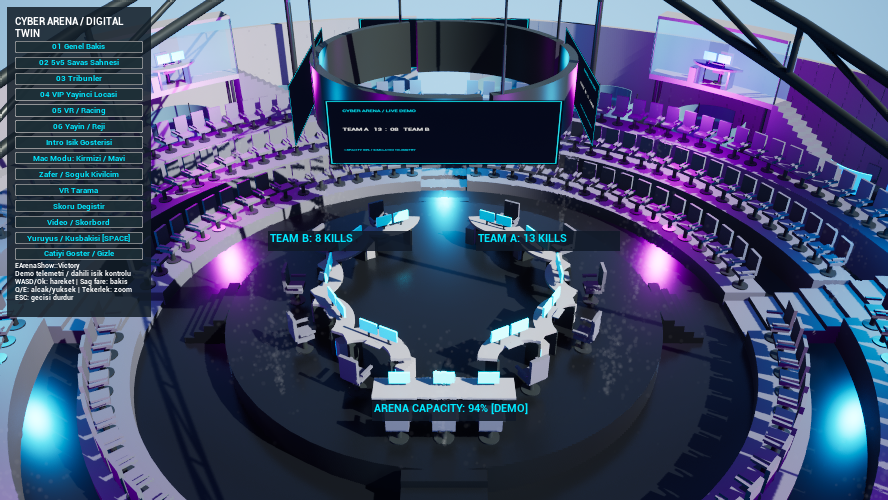
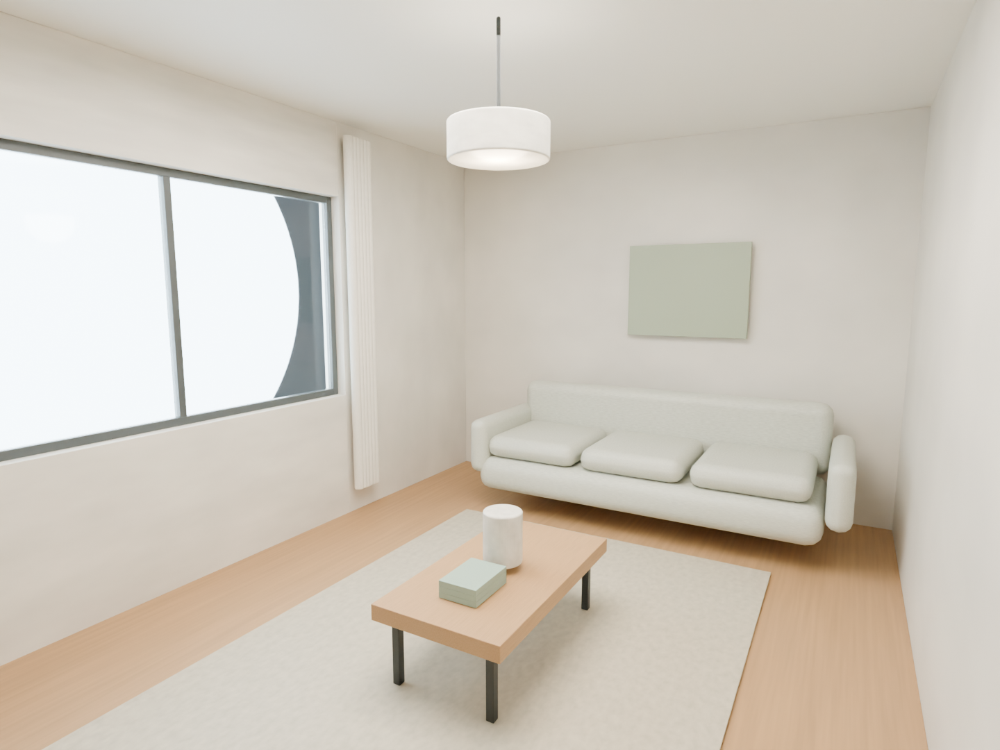

# CAD & Unreal Portfolio

Mimari ve endüstriyel tasarım, parametrik CAD modelleme ve etkileşimli görselleştirme çalışmalarım.

Bu portföy **görseller ve proje açıklamalarından** oluşur. Kaynak kodlar, DWG dosyaları, Unreal varlıkları ve çalıştırılabilir uygulamalar bu depoda paylaşılmaz.

## Seçili çalışmalar

## Projeler

| Proje | Bu depoda |
|---|---|
| [Industrial Facility — Akıllı Fabrika](projects/industrial-facility/README.md) | Görseller ve proje özeti |
| [6+2 Villa — Mimari Görselleştirme](projects/luxury-villa/README.md) | Görseller ve proje özeti |
| [Droneport — Otonom Lojistik Merkezi](projects/droneport/README.md) | Görseller ve proje özeti |
| [E-Spor Arena — Cyber Gaming Hub](projects/esports-arena/README.md) | Görseller ve proje özeti |
| [Yamaç Resort — Sonsuzluk Havuzu](projects/hillside-resort/README.md) | Görseller ve proje özeti |
| [Sci-Art Museum — Modern Sanat Müzesi](projects/sci-art-museum/README.md) | Görseller ve proje özeti |
| [Hyperloop — Yeraltı Transit Terminali](projects/hyperloop-station/README.md) | Görseller ve proje özeti |
| [Biyofilik Dikey Çiftlik — Eko-Gökdelen](projects/biophilic-tower/README.md) | Proje özeti · görsel bekleniyor |
| [Smart Furniture CAD — Modüler Raf](projects/smart-furniture/README.md) | Görseller ve proje özeti |
| [Mini Apartment — İki Yatak Odalı Daire](projects/mini-apartment/README.md) | Görseller ve proje özeti |

## Çalışma sürecim

1. Tasarım amacı, ölçüler, birimler ve varsayımları belirleme.
2. 2D teknik çizim ve parametrik 3D modelleme.
3. Uygun projelerde CAD ortamında hareket senaryoları oluşturma.
4. Unreal veya Blender ile sahne, malzeme, ışık ve kamera çalışmaları.
5. Sonucu görseller ve kapsam sınırlarıyla belgeleme.

Projelerin tümü aynı aşamaları içermez. Örneğin Mini Apartment görselleri Blender çıktısıdır; Industrial Facility Unreal sahnesi özgün DWG'nin birebir aktarımı değildir. Ayrıntılar ilgili proje sayfasındadır.

## AI destekli üretim

Bu eğitim projelerinde AI desteği; planlama, kod üretimi, hata çözümü ve dokümantasyon için kullanıldı. Portföy, öğrenme sürecini ve üretilen çalışmaları gösterir; bütün kodun bağımsız olarak elle yazıldığı iddiası taşımaz.

## Teknik sınırlar

Çalışmalar eğitim ve portföy amaçlı konseptlerdir. İnşaat/imalat onayı, yük kapasitesi sertifikası, mevzuat uygunluğu veya gerçek zamanlı fiziksel tesis bağlantısı iddiası bulunmaz. Simülasyon telemetrisi gerçek cihaz verisi olarak sunulmaz.

## Görsel notu

Görseller mevcut yerel proje çıktılarından alınmıştır. Bazı eski ekran görüntülerinin ışık ve kamera sunumu geliştirmeye açıktır. Kaynak kodlar ve kişisel yerel dosya yolları paylaşım paketine dahil edilmemiştir.
