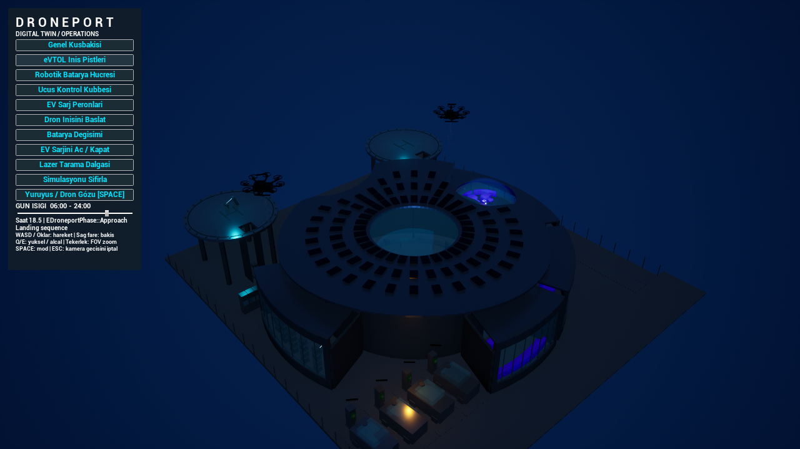

# Droneport — Otonom Lojistik Merkezi

Dron ve elektrikli teslimat araçlarını bir araya getiren lojistik merkezi konsepti.

**Araçlar / çalışma akışı:** AutoCAD · C# · Datasmith · Unreal Engine · C++ · UMG

## Proje kapsamı

CAD modelleme; dron inişi, hidrolik platform, batarya değişimi ve EV şarj durumları; Unreal etkileşim paneli.

## Öğrenme ve portföy değeri

Geometriyi düzenli kurma, ölçü/koordinat ilişkilerini açıklama ve teknik modeli anlaşılır biçimde sunma pratiği. Süreçte AI destekli planlama, kod üretimi ve hata çözümünden yararlanıldı.

## Görseller

### Dron merkezi ve etkileşim paneli

## Kapsam sınırları

Niagara efektleri başlangıç sistemlerine dayanır. Gerçek uçuş kontrolü, robot kalibrasyonu veya donanım bağlantısı bulunmaz.

Bu sayfa kaynak kod veya çalıştırılabilir uygulama dağıtımı değildir. Statik görüntüler tek başına hareket senaryolarının test kanıtı sayılmaz. Açıklamalar mevcut yerel proje belgelerinden derlenmiştir; bu yayın hazırlığında simülasyonlar yeniden çalıştırılmadı.

[Portföy ana sayfası](../../README.md)
