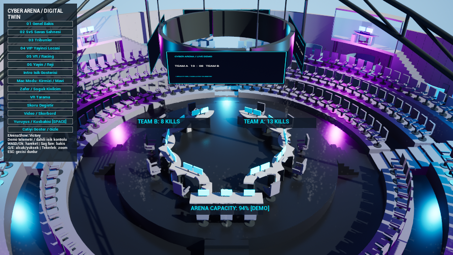

# E-Spor Arena — Cyber Gaming Hub

Arena, VR deneyim alanları ve dijital gösterim sistemleri için mimari sunum.

**Araçlar / çalışma akışı:** AutoCAD · C# · Datasmith · Unreal Engine · C++ · UMG

## Proje kapsamı

DWG aktarımı; LED ve skor ekranları, hareketli spotlar, VR hedefleri ve kamera bölgeleri.

## Öğrenme ve portföy değeri

Geometriyi düzenli kurma, ölçü/koordinat ilişkilerini açıklama ve teknik modeli anlaşılır biçimde sunma pratiği. Süreçte AI destekli planlama, kod üretimi ve hata çözümünden yararlanıldı.

## Görseller

### Arena, merkezi skor ekranı ve kontrol paneli

## Kapsam sınırları

Skor ve doluluk gösterimleri demo verisidir. Canlı video, oyuncu kamerası ve fiziksel DMX donanımı bağlı değildir.

Bu sayfa kaynak kod veya çalıştırılabilir uygulama dağıtımı değildir. Statik görüntüler tek başına hareket senaryolarının test kanıtı sayılmaz. Açıklamalar mevcut yerel proje belgelerinden derlenmiştir; bu yayın hazırlığında simülasyonlar yeniden çalıştırılmadı.

[Portföy ana sayfası](../../README.md)
