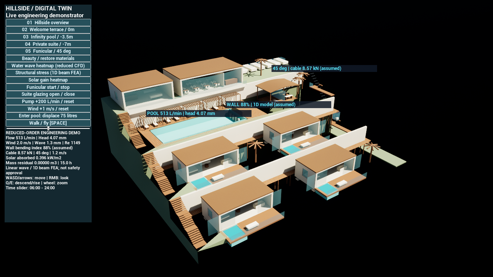

# Yamaç Resort — Sonsuzluk Havuzu

Kademeli yamaç yerleşimi, havuz, süitler ve füniküler ulaşımı birleştiren mimari konsept.

**Araçlar / çalışma akışı:** AutoCAD · C# · Datasmith · Unreal Engine · C++

## Proje kapsamı

CAD modelinden Unreal sahnesi; füniküler ve cam hareketleri, su görselleştirmesi, farklı inceleme modları ve kamera geçişleri.

## Öğrenme ve portföy değeri

Geometriyi düzenli kurma, ölçü/koordinat ilişkilerini açıklama ve teknik modeli anlaşılır biçimde sunma pratiği. Süreçte AI destekli planlama, kod üretimi ve hata çözümünden yararlanıldı.

## Görseller

### Kademeli resort ve havuzların kesit benzeri görünümü

## Kapsam sınırları

Akış ve yapısal gösterimler varsayımlara dayalı eğitim modelleridir; doğrulanmış CFD, yapı güvenliği veya uygulama projesi olarak sunulmaz.

Bu sayfa kaynak kod veya çalıştırılabilir uygulama dağıtımı değildir. Statik görüntüler tek başına hareket senaryolarının test kanıtı sayılmaz. Açıklamalar mevcut yerel proje belgelerinden derlenmiştir; bu yayın hazırlığında simülasyonlar yeniden çalıştırılmadı.

[Portföy ana sayfası](../../README.md)
