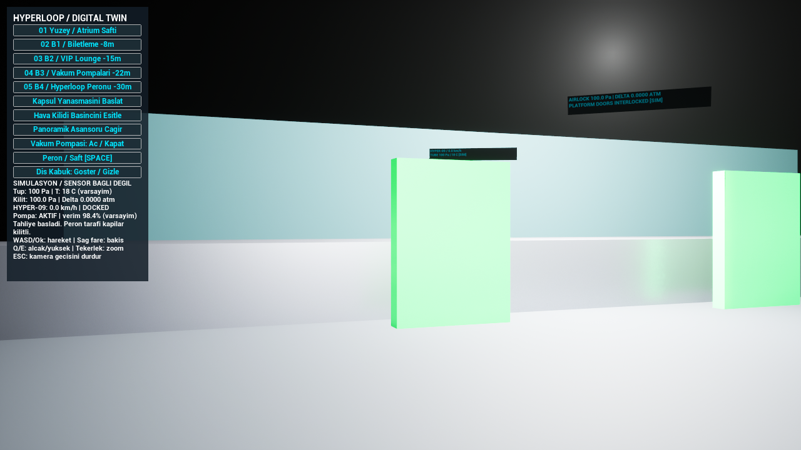

# Hyperloop — Yeraltı Transit Terminali

Yeraltı istasyonunda kapsül, hava kilidi, asansör ve pompa senaryolarını anlatan etkileşimli konsept.

**Araçlar / çalışma akışı:** AutoCAD · C# · Datasmith · Unreal Engine · C++ · UMG

## Proje kapsamı

CAD istasyon modeli; kapsül yaklaşma, kapı kilitleme, basınç eşitleme gösterimi, asansör ve pompa hareketleri.

## Öğrenme ve portföy değeri

Geometriyi düzenli kurma, ölçü/koordinat ilişkilerini açıklama ve teknik modeli anlaşılır biçimde sunma pratiği. Süreçte AI destekli planlama, kod üretimi ve hata çözümünden yararlanıldı.

## Görseller

### Hava kilidi ve demo telemetri arayüzü

## Kapsam sınırları

Telemetri simülasyon verisidir. Sensör bağlantısı, gerçek vakum tesisi doğrulaması veya CFD analizi iddiası yoktur. Görsel genel mimari sunum değil, arayüz/hava kilidi detay önizlemesidir.

Bu sayfa kaynak kod veya çalıştırılabilir uygulama dağıtımı değildir. Statik görüntüler tek başına hareket senaryolarının test kanıtı sayılmaz. Açıklamalar mevcut yerel proje belgelerinden derlenmiştir; bu yayın hazırlığında simülasyonlar yeniden çalıştırılmadı.

[Portföy ana sayfası](../../README.md)
