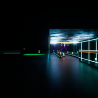

# Industrial Facility — Akıllı Fabrika

Endüstriyel tesisin ofis, üretim ve lojistik alanlarını kapsayan CAD ve etkileşimli sahne çalışması.

**Araçlar / çalışma akışı:** AutoCAD · C# · Unreal Engine · C++ · Python

## Proje kapsamı

2D oda, kapı, mobilya ve lojistik planı; ayrı üreticiyle 3D fabrika; konveyör, robot, vinç ve tır hareketleri; Unreal ışık ve kamera gösterimi.

## Öğrenme ve portföy değeri

Geometriyi düzenli kurma, ölçü/koordinat ilişkilerini açıklama ve teknik modeli anlaşılır biçimde sunma pratiği. Süreçte AI destekli planlama, kod üretimi ve hata çözümünden yararlanıldı.

## Görseller

### Unreal gece sahnesinden mevcut ekran görüntüsü

## Kapsam sınırları

Unreal sahnesi DWG’nin birebir aktarımı değildir; ölçüleri referans alan prosedürel yeniden kurulumdur. Robot hareketleri kalibre edilmiş endüstriyel kontrol veya kapasite doğrulaması değildir.

Bu sayfa kaynak kod veya çalıştırılabilir uygulama dağıtımı değildir. Statik görüntüler tek başına hareket senaryolarının test kanıtı sayılmaz. Açıklamalar mevcut yerel proje belgelerinden derlenmiştir; bu yayın hazırlığında simülasyonlar yeniden çalıştırılmadı.

[Portföy ana sayfası](../../README.md)
