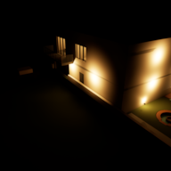

# 6+2 Villa — Mimari Görselleştirme

Bahçeli ve havuzlu villa için mimari modelden etkileşimli gezintiye uzanan çalışma.

**Araçlar / çalışma akışı:** AutoCAD · C# · Datasmith · Unreal Engine · C++ · UMG

## Proje kapsamı

2D/3D CAD tasarımı; DWG sahnesinin Unreal aktarımı; garaj, sürgülü cam, havuz ve gece aydınlatması kontrolleri.

## Öğrenme ve portföy değeri

Geometriyi düzenli kurma, ölçü/koordinat ilişkilerini açıklama ve teknik modeli anlaşılır biçimde sunma pratiği. Süreçte AI destekli planlama, kod üretimi ve hata çözümünden yararlanıldı.

## Görseller

### Villa gece aydınlatmasından mevcut ekran görüntüsü

## Kapsam sınırları

Sahne bağlantıları bu DWG’ye özel eşleştirilmiştir. Su ve aydınlatma etkileşimleri görsel gösterimdir; fiziksel veya mevzuat doğrulaması değildir.

Bu sayfa kaynak kod veya çalıştırılabilir uygulama dağıtımı değildir. Statik görüntüler tek başına hareket senaryolarının test kanıtı sayılmaz. Açıklamalar mevcut yerel proje belgelerinden derlenmiştir; bu yayın hazırlığında simülasyonlar yeniden çalıştırılmadı.

[Portföy ana sayfası](../../README.md)
