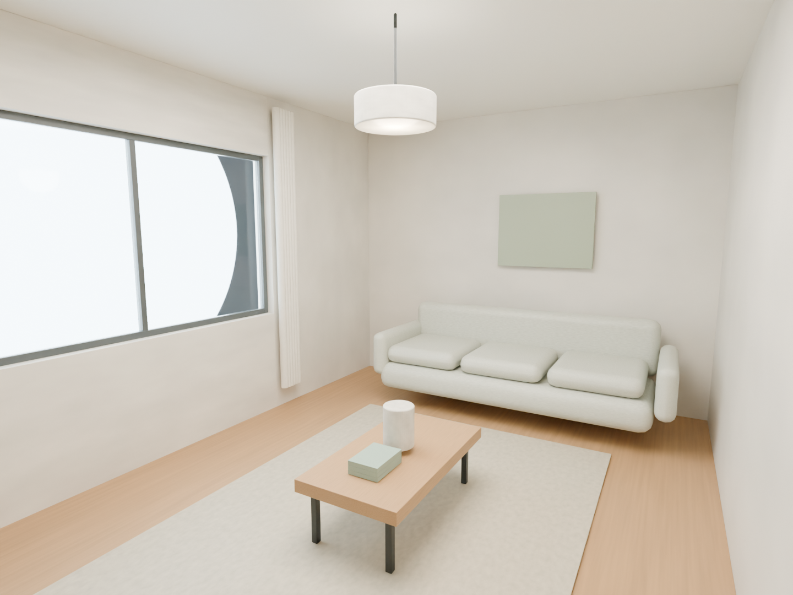
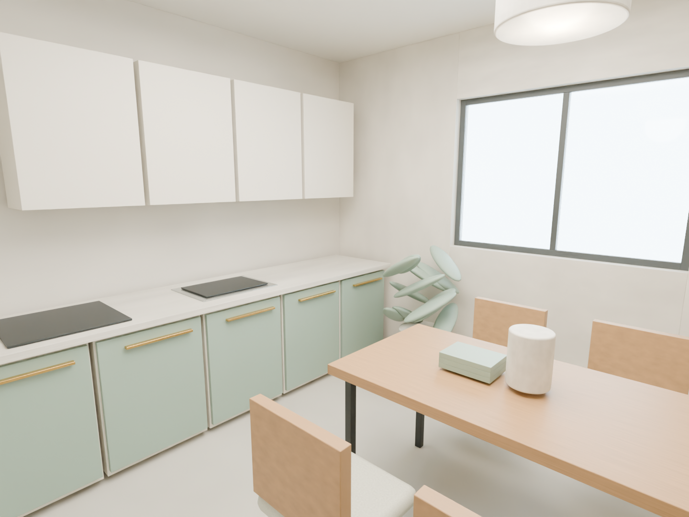
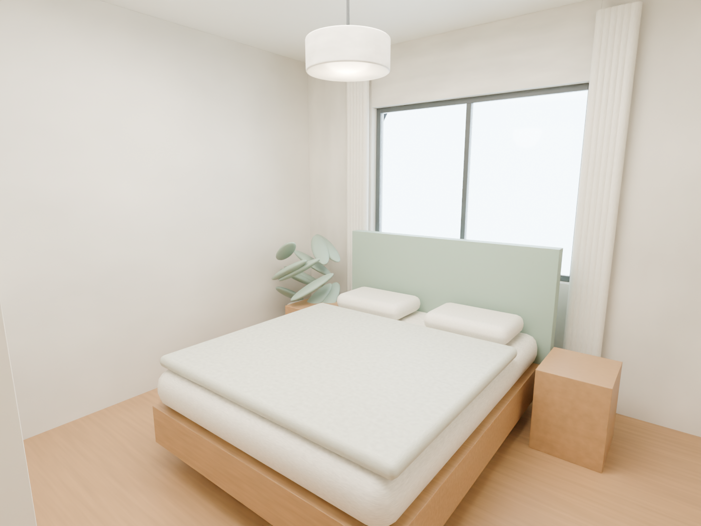
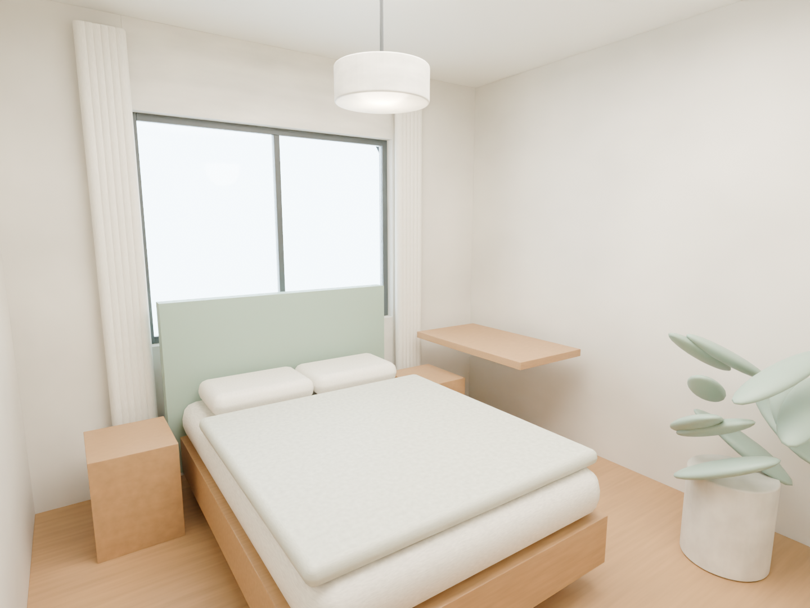
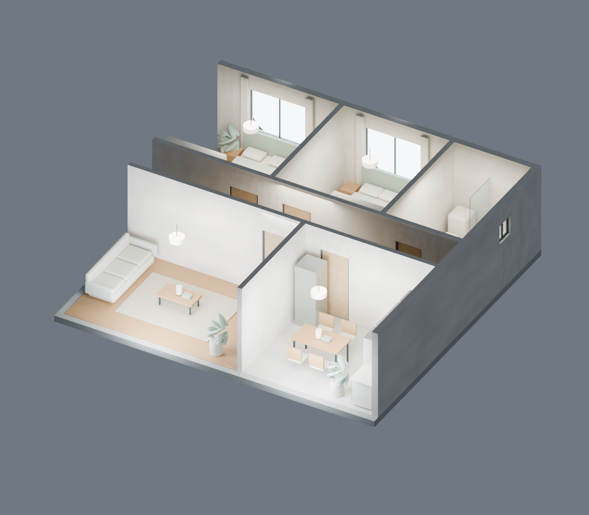

# Mini Apartment — İki Yatak Odalı Daire

Yaklaşık 80 m² net alan hedefli kompakt konut eğitim projesi; hesaplanan net alan 79,935 m², brüt alan 92,00 m².

**Araçlar / çalışma akışı:** AutoCAD uyumlu DXF · Blender · Mimari görselleştirme

## Proje kapsamı

Ölçülü plan, iki kesit, dört cephe, mahal ve eleman çizelgeleri, düzenlenebilir 3D geometri, dört iç mekân renderı ve kesit izometrik görünüm.

## Öğrenme ve portföy değeri

Geometriyi düzenli kurma, ölçü/koordinat ilişkilerini açıklama ve teknik modeli anlaşılır biçimde sunma pratiği. Süreçte AI destekli planlama, kod üretimi ve hata çözümünden yararlanıldı.

## Görseller

### Salon renderı

### Mutfak renderı

### Birinci yatak odası

### İkinci yatak odası

### Kesit izometrik görünüm

## Kapsam sınırları

DWG veya native Revit modeli üretilmedi. AutoCAD lisansı sona erdiği için AutoCAD çalışma zamanı doğrulaması yapılmadı. Mevzuata uygun uygulama projesi değildir.

Bu sayfa kaynak kod veya çalıştırılabilir uygulama dağıtımı değildir. Statik görüntüler tek başına hareket senaryolarının test kanıtı sayılmaz. Açıklamalar mevcut yerel proje belgelerinden derlenmiştir; bu yayın hazırlığında simülasyonlar yeniden çalıştırılmadı.

[Portföy ana sayfası](../../README.md)
