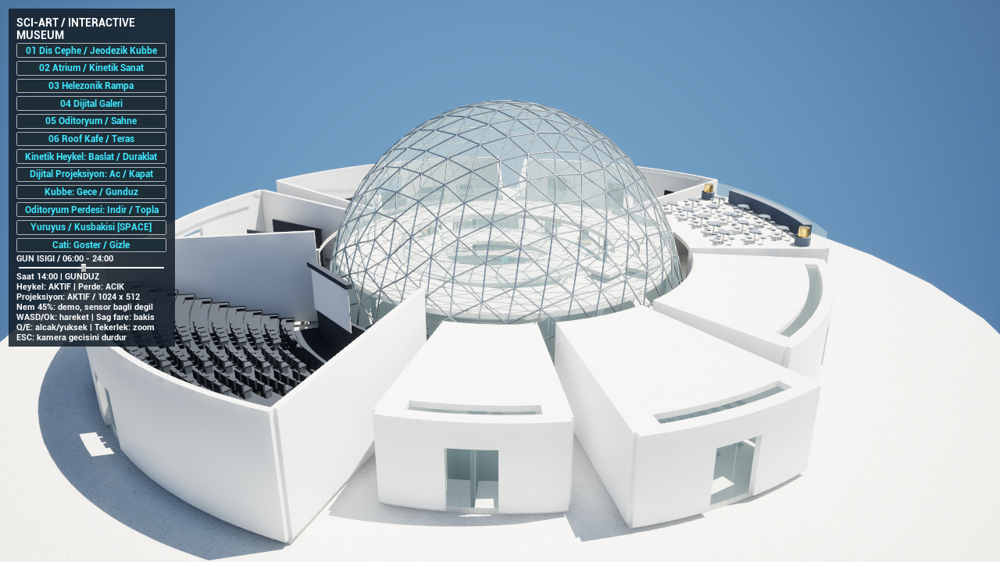

# Sci-Art Museum — Modern Sanat Müzesi

Jeodezik kubbe ve kinetik sanat öğeleriyle etkileşimli müze deneyimi.

**Araçlar / çalışma akışı:** AutoCAD · C# · Datasmith · Unreal Engine · C++ · UMG

## Proje kapsamı

CAD ve Unreal sahneleri; kinetik heykel, galeri kamera bölgeleri, gece gösterimi ve kullanıcı kontrolleri.

## Öğrenme ve portföy değeri

Geometriyi düzenli kurma, ölçü/koordinat ilişkilerini açıklama ve teknik modeli anlaşılır biçimde sunma pratiği. Süreçte AI destekli planlama, kod üretimi ve hata çözümünden yararlanıldı.

## Görseller

### Kubbe ve müze girişinin Unreal görünümü

### Müze dış görünüşü

## Kapsam sınırları

Kamera transferleri sinematik geçişlerdir; yaya rota planlama sistemi değildir. Çalışma eğitim ve görselleştirme amaçlıdır.

Bu sayfa kaynak kod veya çalıştırılabilir uygulama dağıtımı değildir. Statik görüntüler tek başına hareket senaryolarının test kanıtı sayılmaz. Açıklamalar mevcut yerel proje belgelerinden derlenmiştir; bu yayın hazırlığında simülasyonlar yeniden çalıştırılmadı.

[Portföy ana sayfası](../../README.md)
