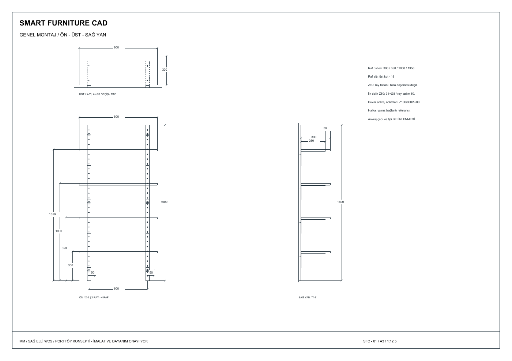

# Smart Furniture CAD — Modüler Raf

800 × 300 × 18 mm ölçülerinde dört raf ve iki ayarlanabilir duvar rayından oluşan sistem.

**Araçlar / çalışma akışı:** AutoCAD uyumlu CAD · Parametrik tasarım · Teknik resim

## Proje kapsamı

Ön/üst/yan teknik görünüşler, ölçüler, 3D montaj, patlatılmış montaj, parça listesi ve geometri kontrol raporları.

## Öğrenme ve portföy değeri

Geometriyi düzenli kurma, ölçü/koordinat ilişkilerini açıklama ve teknik modeli anlaşılır biçimde sunma pratiği. Süreçte AI destekli planlama, kod üretimi ve hata çözümünden yararlanıldı.

## Görseller

### Ölçülü raf sistemi teknik paftası

## Kapsam sınırları

Duvar ankrajları, kaynak detayları ve güvenli taşıma kapasitesi doğrulanmadı. Üretime hazır veya sertifikalı ürün değildir.

Bu sayfa kaynak kod veya çalıştırılabilir uygulama dağıtımı değildir. Statik görüntüler tek başına hareket senaryolarının test kanıtı sayılmaz. Açıklamalar mevcut yerel proje belgelerinden derlenmiştir; bu yayın hazırlığında simülasyonlar yeniden çalıştırılmadı.

[Portföy ana sayfası](../../README.md)
